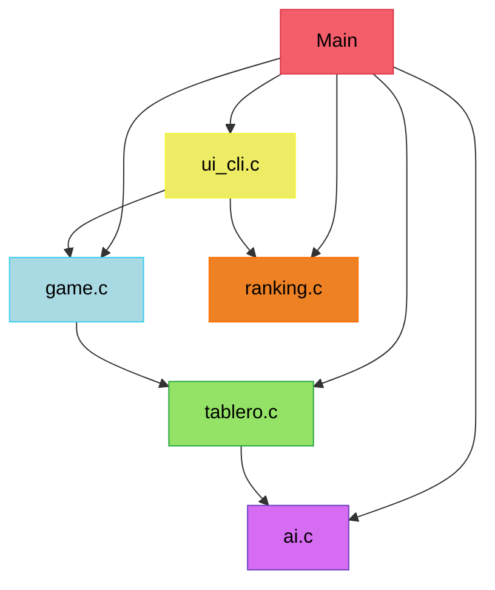

# BATALLA NAVAL

## INTRODUCCIÓN: 
Versión Clásica del Juego **BATALLA NAVAL**, ahora con la implementación del Modo **Tormenta**.  
Desarrollado en el Lenguaje C, para su uso por Consola y por Interfaz gráfica. 
Proyecto realizado por Estudiantes de la Carrera Analista Programador Universitario, de la Universidad Nacional de la Patagonia San Juan Busco, para la Cátedra Algorítmica y Programación I, dictada por los Profesores Juan Manuel Cortez, Martín Ebene y Gustavo Pazos. 

<br> 

## INDICE
1) Integrantes del Proyecto <br> 
2) Reglamento y Desarrollo. <br> 
3) Modos (Jugadores - IA) y Dificultad (Normal - Tormenta) <br> 
4) Juguemos una partida <br> 
5) Archivos <br> 
6) Compilación y Ejecución <br> 

<br> 

## 1) INTEGRANTES DEL PROYECTO:

| NOMBRES Y APELLIDOS                       | APORTES REALIZADOS         |
|-------------------------------------------|----------------------------|
|Vicente Tomás Rodríguez Pi                 |main, ui_cli                |
|                                           |                            |
|Teresa de los Angeles Carabajal Anderson   |game, tablero, documentación|
|                                           |                            |
|Gianfranco Di Pisa Echagüe                 |ia, ranking                 |
|                                           |                            |
|Huenú Rosalba Beatriz Margalef Quijada     |game, tablero               |
|                                           |                            |

<br> 

## 2) REGLAMENTO y DESARROLLO DEL JUEGO. 
#### a) Tableros: 
* Tamaño 10x10. 100 Casillas*. <br> 
* Tablero de Barcos (En Adelante solo "Tablero"): Se registran los barcos del Jugador de Turno, y se actualiza según los Disparos DEL enemigo. <br> 
* Tablero de Disparos: Para llevar un registro de los Disparos AL enemigo. <br> 
* Al inicio de cada Partida, ambos Tableros solo contienen Agua. <br> 
* Para el ingreso de la Flota y para dar las Coordenadas de ataque, solo se Permite:
    - Ingreso Numeral de la Fila (1 al 10). <br> 
    - Ingreso Alfabético de la Columna (A a J). <br> 
* La *FLOTA* de cada Jugador consiste en 5 barcos, que se diferenciarán de acuerdo a su nombre/tamaño respectivamente. <br> 


**Tipo y tamaño del barco**

|Cantidad|**FLOTA**         | **TAMAÑO**  | 
|:------:|:----------------:|:-----------:|
| 1      |    porta_aviones | 5 casilleros|
| 1      |    buque         | 4 casilleros|
| 1      |    submarino     | 3 casilleros|
| 1      |    velero        | 2 casilleros|
| 1      |    lancha        | 1 casillero |

<br> 


**Menú Principal**


**Selección de Dificultad**


  
#### b) Flota e Ingreso de Barcos:      
* No se permite el ingreso de ubicación fuera de rango. <br>
* No se permite el ingreso del barco, si por su tamaño (cantidad de casillas que ocupe), no entra completo en el Tablero. <br> 
* No se permite el ingreso de ubicación repetida. <br> 
* No se permite que los barcos se superpongan.  <br> 
* No se permite que los barcos se encuentren ubicados en posiciones contiguas, ni en diagonal. (Al menos una casilla de distancia entre ellos).<br> 


**Ingreso de Flota**

<br> 


#### c) Disparos. Ataque a Flota Oponente.
* El Atacante es el jugador de Turno. Solo tiene permitido hacer un (1) único disparo por turno. <br> 
* El Disparo consiste en elegir (y escribir) una Fila y Una Columna.
* Si el Disparo alcanzó un Barco, se confirma por Pantalla y se actualizan los tableros. En el Tablero Impacto a Barco es 'X' . <br> 
* Si el Disparo fue a agua, entonces en pantalla "AGUA". En el tablero Impacto a Agua se representa con un '0'. <br> 
* No se permite el ingreso de ubicación repetida. De ser el caso, se solicitan nuevas coordenadas.<br> 


**Disparos**

 <br> 


#### d) Partidas-Condiciones de Victoria:<br> 
Al iniciar la Partida, se solicita el nombre del jugador, y a traves de un Menú el usuario accederá a opciones sobre Modo de Juego y Dificultad que debera elegir para continuar la partida. <br> 
Entre turno de jugadores, se ha implementado una pantalla cortina para separar los turnos, para evitar ver el tablero del adversario. <br>
El Ganador de la Partida es el Jugador que lográ Hundir los 5 barcos de la flota Enemiga. Y con ello, se le suma 1 (una) Victoria en *ranking* <br> 


## 3) MODOS DE JUEGO <br> 
a) JUGADOR1 VS JUGADOR2: CLASICO Y TORMENTA<br> 
b) JUGADOR VS IA (MÁQUINA): CLASICO Y TORMENTA<br> 


#### a) JUGADOR1 VS JUGADOR2:<br> 
Enfrentamiento entre Personas.<br> 
La interfaz muestra al jugador de turno sus tableros. En **Tablero** se muestra la situación actual de su Flota, y en **Tablero de Disparos** lleva un registro de sus operaciones tácticas. <br>
Como se mencionó anteriormente, mediante una cortina, se concede el turno al siguiente jugador y así se oculta la ubicación de la flota del oponente. <br> 

#### b) JUGADOR VS IA<br> 
Enfrentamiento entre un Jugador y la Máquina.<br> 
Durante el Turno de la Máquina, en pantalla sólo se muestra el tablero del Jugador y un Mensaje indicando las coordenadas del ataque de la Máquina y su resultado. Habrá una cortina para indicar cambio de Turno. <br>

## DIFICULTAD  <br> 

#### a) DIFICULTAD NORMAL
Juego Clásico, sea el modo elegido (Entre Jugadores o Contra IA). No difiere en uso, ni métodos adicionales, ni estratégicas ya conocidas y/o antes mencionadas. <br>

#### b) DIFICULTAD TORMENTA APTO PARA JUGAR EN AMBOS MODOS.

1) El jugador de turno dispara a flota enemiga.  <br>
2) Al activarse la Tormenta, un rayo realizará un Impacto a un barco del Jugador defensor. <br>
* El barco se elige de forma aleatoria entre la flota del Jugador defensor. <br>
* El impacto por Tormenta se verá en el tablero con el simbolo "/". <br> 

#### i) TORMENTA POR TURNOS:<br>
Se activa cada 3 turnos. <br>

#### ii) TORMENTA POR IMPACTOS CONSECUTIVOS A AGUA.<br>
Se Activa Tormenta Cuando el jugador de Turno, haya hecho Impacto a Agua, en sus tres turnos consecutivos.<br>

**¿Cómo funciona Tormenta por Impactos Consecutivos a Agua?**<br> 

Caso 1:<br> 
impacto_agua_consecutivo=0 (contador inicializado en 0) <br> 
Turno 1: Atacante dispara a Agua (impacto_agua_consecutivo + 1). <br> 
Turno 2: Atacante dispara a Agua (impacto_agua_consecutivo + 1). <br> 
Turno 3: Atacante dispara a Agua (impacto_agua_consecutivo + 1). <br> 
impacto_agua_consecutivo=3 Se Activa Tormenta. <br> 
<br>
Caso 2: <br> 
impacto_agua_consecutivo=0 (contador inicializado en 0). <br> 
Turno 1: Atacante dispara a Agua (impacto_agua_consecutivo + 1). <br> 
Turno 2: Atacante dispara a Agua (impacto_agua_consecutivo + 1). <br> 
Turno 3: Atacante dispara a Barco (impacto_agua_consecutivo= 0) -> se reinicia el contador. <br> 

**Modo Tormenta**

<br> 
<br> 

## 4) JUGUEMOS UNA PARTIDA / FLUJO GENERAL                           
1. Solicitud del nombre del primer jugador.<br>
2. Saludo
3. Reglamento.<br>
4. Menú:
    * Para elegir Modo "Jugador contra Jugador" o "Jugador contra Máquina". <br>
    * Para mostrar el Ranking y el Reglamento.
    * Opción "Salir del Juego".
5. Menú Dificultad: "Partida Normal" o "Tormenta".<br>
6. En Jugador contra Jugador, solicitud del nombre del segundo jugador.<br>
7. En Cualquier Modo/Dificultad elegida: Cada jugador deberá ingresar sus barcos por teclado, fila, columna, y especificar su orientación (horizontal o vertical).<br>
8. Desarrollo de la partida. <br>
    * Cada Jugador tendrá solo un disparo por Turno. Deberá ingresar coordenada de ataque (Fila y Columna), el tipo de impacto se indicará mediante Mensaje de Aviso y se verá reflejado en el Tablero de Disparos del Atacante y en el Tablero de Barcos del Adversario. 
    * En Jugador contra Jugador, una pantalla de espera separa los turnos, para que el siguiente jugador no vea el tablero del adversario.<br>
    En Jugador contra la IA: Durante el Turno de la Máquina, en pantalla muestra los tableros del Jugador y un Mensaje del lugar en donde disparó y su resultado. Habrá una cortina para indicar cambio de Turno.<br>
9. Mensaje de victoria, cuando la flota enemiga haya sido destruida.<br>
10. Menú (Para indicar si volver a Jugar o salir).<br>

<br>

## 5) ARCHIVOS: 
#### De que trata cada Archivo y cual es su vínculo<br>

### Diagrama de Dependencias


### Arbol de Directorios

```
BATALLA_NAVAL/
|
├── bin/
│   └── batalla_naval.exe
|
├── data/
│   └── ranking.dat
│
├── files/
│   └── Reglamento.txt
│
├── img/
│   ├── image Menu.png
│   ├── image-1 Dificultad.png
│   ├── image-2 Flota.png
│   ├── image-3 Disparos.png
│   ├── image-5 Tormenta.png
│   └── image-6 Tormenta.png
│ 
├── include/
│   ├── ai.h
│   ├── config.h
│   ├── game.h
│   ├── ranking.h
│   ├── tablero.h
│   └── ui_cli.h
│
├── obj/
│   ├── ai.o
│   ├── game.o
│   ├── main.o
│   ├── ranking.o
│   ├── tablero.o
│   └── ui_cli.o
│
├── src/
│   ├── ai.c
│   ├── game.c
│   ├── main.c
│   ├── ranking.c
│   ├── tablero.c
│   └── ui_cli.c
│
├── Makefile
│
└── README.md
```
### Descripción de módulos

* **`config.h`:** Define las macros y constantes compartidas por todo el proyecto (dimensiones del tablero, cantidad y tamaños de barcos, etc.).
* **`main.c`:** Punto de entrada del programa. Integra los módulos y coordina el flujo general según el modo de juego y la dificultad elegidos.
* **`ui_cli.c` / `ui_cli.h`:** Gestiona la entrada y salida por consola: lectura de nombres, opciones de menú, coordenadas y orientación de barcos, y dibujado de tableros y mensajes.
* **`game.c` / `game.h`:** Controla el ciclo de cada partida: inicialización, cambios de turno, procesamiento de disparos sobre los tableros de ataque y defensa, lógica del modo tormenta y detección del fin del juego.
* **`tablero.c` / `tablero.h`:** Inicializa los tableros y valida la colocación de los barcos (que entren completos dentro de los límites y no se superpongan).
* **`ai.c` / `ai.h`:** Implementa la lógica de elección de jugadas de la máquina en las partidas contra la CPU.
* **`ranking.c` / `ranking.h`:** Administra el archivo binario `ranking.dat` para guardar las victorias por jugador y mostrar el ranking ordenado de mayor a menor.
* **`bin/` / `obj/`:** Se generan durante la compilación del programa.


## 6) COMPILACIÓN Y EJECUCIÓN 
## Compilación y ejecución

### Requisitos
- Compilador `gcc` con soporte para **C11**
- Utilidad `make`
- Entorno con comandos Unix (`mkdir -p`, `rm -rf`), como **MSYS2 / Git Bash** en Windows, **WSL** o una terminal **Linux**

### Compilar
Desde la raíz del proyecto, ejecutar:
```bash
make
```
Esto generará el ejecutable en `bin/batalla_naval.exe` y los archivos objeto en `obj/`.

### Ejecutar
Para iniciar el programa, ejecutar desde la raíz:
```bash
./bin/batalla_naval.exe
```

### Limpiar archivos compilados
Para eliminar los archivos generados con la compilación:
```bash
make clean
```