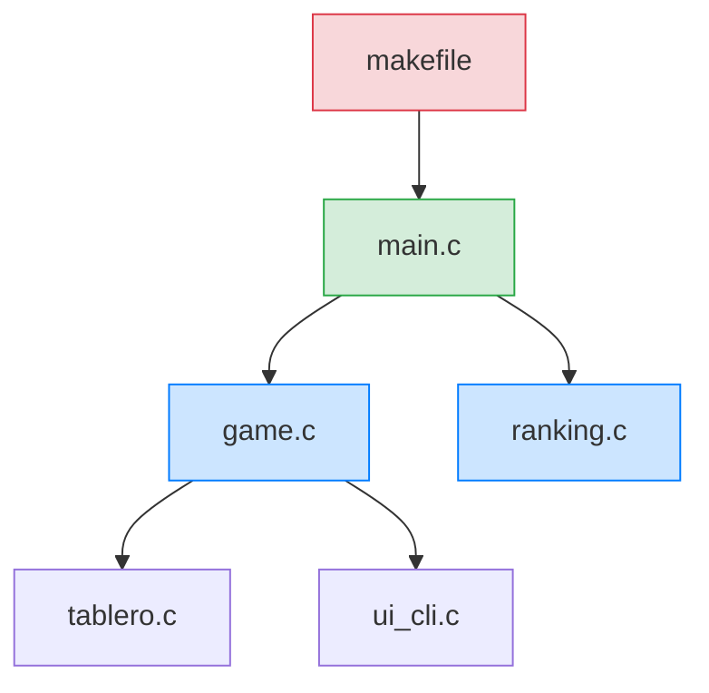
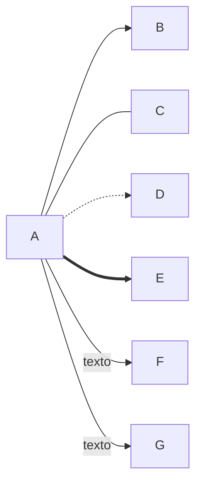

# BATALLA NAVAL

## Introducción: 
Reversión Clásica del Juego **BATALLA NAVAL**, ahora con la implementación del Modo **Tormenta**. <br> 
Desarrollo en el Lenguaje C, para su uso por Consola e Interfáz gráfica. <br> 
Proyecto realizado por Estudiantes de la Carrera Analista Programador Universitario, de la Universidad Nacional de la Patagonia San Juan Busco, para la Cátedra Algoritmica y Programación I, dictada por los Profesores Juan Manuel Cortez, Martín Ebene y Gustavo Pazos. 

## Indice
A) Integrantes del Proyecto <br> 
B) Reglamento y Desarrallo. <br> 
C) Modos (Jugadores - IA) y Dificultad (Normal - Tormenta) <br> 
D) Juguemos una partida
E) Archivos <br> 
F) Compilación y Ejecución <br> 
G) Comentarios <br> 


### INTEGRANTES DEL PROYECTO ###<br>

| NOMBRES Y APELLIDOS                     | HS TRABAJADAS  |
|-----------------------------------------|----------------|
|Vicente Pi Rodriguez                     |-------X--------|
|                                         |                |
|Teresa de los Angeles Carabajal Anderson |-------X--------|
|                                         |                |
|Gianfranco Di Pisa Echagüe               |-------X--------|
|                                         |                |
|Huenú Rosalba Margalef Quijada           |-------X--------|
|                                         |                |


### REGLAMENTO y DESARROLLO DEL JUEGO. 

#### Tableros: 
*Tamaño 10x10. 100 Casillas*. <br> 
Tablero: Flota del Jugador de Turno. <br> 
Tablero de Disparos: En él se lleva un registro de los Disparos al enemigo. <br> 
Al inicio de cada Partida, ambos Tableros solo contienen Agua. <br> 
La *FLOTA* de cada Jugador consiste en 5 barcos, que se diferenciarán de acuerdo a su nombre/tamaño respectivamente. <br> 

**Tipo y tamaño del barco**
|Cantidad|**FLOTA**         | **TAMAÑO**  | 
|:------:|:----------------:|:-----------:|
| 1      |    porta_aviones | 5 casilleros|
| 2      |    buque         | 4 casilleros|
| 3      |    submarino     | 3 casilleros|
| 4      |    lancha        | 2 casilleros|
| 5      |    velero        | 1 casilleros|
  
**Posiciones Válidas:** 
*Ingreso Numeral de la Fila (1 al 10). <br> 
*Ingreso Alfabético de la Columna (A a J). <br> 
*No se permite que los barcos se superpongan.  <br> 
*No se permite que los barcos se encuentren ubicados en posiciones contiguas, ni en diagonal. (Dejar un espacio entre ellos).<br> 
*No se permite el ingreso de ubicación repetida (Ni como coordenada de Ataque). <br> 
*No se permite el ingreso de ubicación fuera de rango. <br>
*No se permite el ingreso del barco, si por su tamaño (cantidad de casillas que ocupe), no entra en el rango del Tablero. <br> 
*La interfaz se ocupa de traducir las coordenadas ingresadas por las personas a las coordenadas que utiliza el programa.


**Disparos. Ataque a Flota Oponente.**
El Atacante es el jugador de Turno. Solo tiene permitido hacer un (1) único disparo por turno. <br> 
Si el Disparo alcanzó un Barco, entonces en pantalla "IMPACTO". (*tablero.c*). <br> 
Si el Disparo fue a agua, entonces en pantalla "AGUA". <br> 
Si la ubicación ingresada es repetida, en pantalla "Vuelva a Intentar". <br> 

**Partidas:**
La cantidad de Partidas depende del/de los jugadores. <br> 
El Ganador de la Partida es el Jugador que lográ Hundir los 5 barcos de la flota Enemiga. Y con ello, se le suma 1 (una) Victoria en *ranking.c* <br> 
Al iniciar la Partida, el usuario accederá desde el Menú a opciones sobre Modo de Juego y Dificultad. <br> 
Cabe aclarar que en las Partidas entre Jugador1 vs Jugador2, se ha implementado una pantalla cortina para separar los turnos, y evitar ver el tablero del adversario. <br>


|                          MENÚ PRINCIPAL                            |
|--------------------------------------------------------------------|
|Seleccionar modo de juego:                                          |
|                                                                    |
|    1. Jugador vs Jugador                                           |
|    2. Jugador vs IA                                                |
|--------------------------------------------------------------------|
|    3. Mostrar ranking.                                             |  
|    4. Mostrar reglamento.                                          |
|    0. Salir del juego.                                             |   
|--------------------------------------------------------------------|
|Ingrese una opción:                                                 |

<br> 

### MODO JUGADOR1 VS JUGADOR2 || MODO JUGADOR VS IA (MÁQUINA) || DIFICULTAD ###
**JUGADOR1 VS JUGADOR2:**
Enfrentamiento entre Personas.
La interfaz muestra al jugador de turno sus tableros. En **Tablero** se muestra la situación actual de su Flota, y en **Tablero de Disparos** lleva un registro de sus operaciones tácticas. <br>
Como se mencionó anteriormente, mediente una cortina, se concede el turno al siguiente jugador y así se oculta la ubicación de la flota del oponente. <br> 

**MODO VS IA**
Enfrentamiento entre un Jugador y la Máquina.

## DIFICULTAD NORMAL || DIFICULTAD TORMENTA ##

**MODO NORMAL**
Juego Clásico, sea el modo elegido (Entre Jugadores o Contra IA). No difiere en uso, ni métodos adicionales, ni estratégicas ya conocidas y/o antes mencionadas. <br>

**MODO TORMENTA**
**TORMENTA POR TURNOS**:
Cada 3 turnos, ocurrirá un impacto. Elegido esta dificultad el jugador de turno tendrá dos ventajas:
1) Podrá disparar a la flota enemiga.  <br>
2) Sin importar si acertó o no, con Tormenta el adversario tendrá su flota en peligro debido a que por coordenada aleatoria elegido por el sistema, un rayo impactará sobre un barco activo.  <br> 
No permite el hundimiento total del barco, (excepto que se trate de una lancha, que por su tamaño solo ocupa una casilla), sino que hace impacto sobre alguna casilla que ocupe el barco. <br>

**TORMENTA POR IMPACTOS CONSECUTIVOS A AGUA.**
Cuando el jugador de Turno, haya fallado 3 veces, es decir disparó a AGUA, entonces se Activa Tormenta. 
El adversario tendrá su flota en peligro debido a que por coordenada aleatoria elegido por el sistema, un rayo impactará sobre un barco activo.  <br> 
No permite el hundimiento total del barco, (excepto que se trate de una lancha, que por su tamaño solo ocupa una casilla), sino que hace impacto sobre alguna casilla que ocupe el barco. <br>

¿Cómo funciona? 
Caso 1:
impacto_agua_consecutivo=0 (contador inicializado en 0)
Turno 1: Atacante dispara a Agua (impacto_agua_consecutivo + 1)
Turno 2: Atacante dispara a Agua (impacto_agua_consecutivo + 1)
Turno 3: Atacante dispara a Agua (impacto_agua_consecutivo + 1)
impacto_agua_consecutivo=3 Se Activa Tormenta 

Caso 2:
impacto_agua_consecutivo=0 (contador inicializado en 0)
Turno 1: Atacante dispara a Agua (impacto_agua_consecutivo + 1)
Turno 2: Atacante dispara a Agua (impacto_agua_consecutivo + 1)
Turno 3: Atacante dispara a Barco (impacto_agua_consecutivo= 0)     // se reinicia el contador


### JUGUEMOS UNA PARTIDA / FLUJO GENERAL ###                           
1. Presentación.
2. Reglamento.
3. Solicitud del nombre del primer jugador.
4. Menú para elegir "jugador contra jugador" o "jugador contra máquina". 
5. Menú para elegir dificultad "Partida Normal" o "Tormenta".
6. En jugador contra jugador, solicitud del nombre del segundo jugador.
7. Cada jugador coloca sus barcos manualmente, en horizontal o vertical.
8. Desarrollo de la partida. En jugador contra jugador, una pantalla de espera separa los turnos para que el siguiente jugador   no vea el tablero del adversario.
9. Pantalla de victoria.
10. Actualización y presentación del ranking.
11. Opción de volver al menú o salir.

Aclaración: Si la dificultad elegida es Tormenta entonces cada tres turnos, uno de los jugadores recibirá un impacto sobre algun cuadrante que ocupe el barco. El hecho ocurre cada 3 turnos. 

### ARCHIVOS ###



**main.c** <br>
Se encarga de la Presentación y Reglamento. Permite el flujo general del programa, cuya ejecución difiere según la decisión del/los jugadores respecto a Modo y Dificultad. También se encarga de la coordinación de la colocación de Barcos y Cambios de turno. <br>

**ui_cli.h**<br>
Contiene las funciones y declaraciones de variables necesarias que se implementarán en "ui_cli.c"<br>

**ui_cli.c**<br>
Se encarga de la interacción por consola con el jugador. Contiene funciones para la solicitud del nombre, coordenadas y orientación de la flota (Requiere validación, para traducir letras de columnas a índices numéricos). Coordenadas de ataque. Mensaje del lugar de Impacto y Victoria. Como así también se encarga de limpiar la consola, de acuerdo al Sistema Operativo que se esté usando. <br>

**config.h** <br>

**game.h** <br>
Contiene las funciones y declaraciones de variables necesarias que se implementarán en "game.c"<br>

**game.c** <br>
Administra el inicio de cada partida, los cambios de turno, comprueba si la partida finalizó (por inexistencia de barcos activos). Procesa los disparos y administra los cambios pertinentes en Tablero de Disparos (Jugador de Turno) y Tablero (Defensor). Y la lógica del juego en Modo tormenta. <br>

**tablero.h** <br>
Contiene las funciones y declaraciones de variables necesarias que se implementarán en "tablero.c". <br>

**tablero.c** <br>
Inicializa los tableros con Agua. Valida que los barcos se ubiquen dentro de los límites del tablero y que los mismos no se superpongan.<br>
El tamaño del barco, en terminos de ubicación, refiere a la cantidad de cuadrantes que ocupa, por lo que también "tablero.c" se encarga de validar que el barco entre completamente. <br> 
Cuando cumpla con las condiciones, solo entonces, actualiza Agua por Barco. <br>

**ranking.c**<br>

**ranking.c**<br>

**demo_ranking**<br>

**gitignore**<br>


### COMPILACIÓN Y EJECUCIÓN ###<br>
Para Compilar Batalla Naval se requiere la herramienta Make, que leerá el archivo Makefile. Con Makefile, automatizamos la compilación y vinculamos los archivos. <br>

**PASOS PARA COMPILAR:**<br>


## ELIMINAR ESTO ANTES DE ENTREGAR EL README ##


/*  TENER EN CUENTA: CONSIGNA DEL TRABAJO. BORRAR DDEL README, AL COMPLETARLO
1) El programa pedirá el nombre del jugador, lo saludará y presentará las reglas o instrucciones antes de
jugar.

2) El programa debe permitir completar una partida. Al finalizar, mostrará el ranking o un resumen de
resultados/puntajes, según corresponda al juego elegido, y permanecerá en esa pantalla hasta que el
usuario presione una tecla; luego finalizará.  
Como alternativa optativa se admite una interfaz gráfica; se sugiere SDL3, biblioteca para C. 

3) Se entregará el código fuente .c y .h, los recursos indispensables y las instrucciones para compilar y
ejecutar el programa. El ejecutable solo no constituye una entrega suficiente.

4) El archivo README.md será el único informe obligatorio. De manera breve, incluirá:
    a. Integrantes y aportes/horas aproximadas por cada uno.
    b. Reglas y alcance del juego.
    c. Instrucciones para compilar, ejecutar y controlar el juego
    d. Organización general de datos y funciones
    e. Si hay interfaz gráfica, también indicará qué funciones conectan la interfaz con la lógica y qué
    parte gráfica se generó mediante IA.
● El README.md podrá incluir opcionalmente capturas de pantalla, imágenes, tablas o diagramas para
facilitar la explicación. Se sugiere Mermaid para elaborar diagramas sencillos (por ejemplo, el recorrido
de una jugada o la relación entre las partes del programa) directamente en el README.md, donde
GitHub puede visualizarlos. Los archivos gráficos utilizados deberán formar parte del repositorio y
estar enlazados desde el README.md.

5) EXPOSICIÓN ORAL: 
    GRUPO: 8 MINUTOS.  
    Mostrar una partida o secuencia representativa y explicar, de forma breve, cómo se organizaron los datos y las funciones.

    INDIVIDUAL: 3- 4 MINUTOS
    Responder preguntas sobre localizar una función, seguir manualmente una jugada, identificar un caso
    límite o proponer o realizar un cambio pequeño y acotado. Se evaluará la comprensión del proyecto
    desarrollado.

6) Preguntas orientativas:

    ● ¿Qué datos representan el estado actual de la partida? Señalalos en el código y explicá cuándo
    cambian.

    ● ¿Por dónde empieza el programa? Mostrá el recorrido desde el menú/inicio hasta una jugada
    concreta.

    ● ¿Qué función decide si una jugada es válida? ¿Qué devuelve o qué cambia cuando es inválida?

    ● ¿Qué funciones elegiste separar y por qué? ¿Qué problema habría si las unieras en una sola?

    ● ¿Qué parámetros recibe una función X y qué resultado produce? ¿Por qué?

    ● ¿Cómo se determina el fin de la partida y el resultado? ¿Dónde se calcula el ranking?

    ● ¿Qué ocurre si el jugador ingresa una opción fuera de rango, repite una jugada o no quedan
    movimientos?

    ● ¿Qué parte del programa cambiarías para modificar una regla sin alterar el resto?

    ● Si aparece un resultado incorrecto, ¿cómo localizarías la función responsable y cómo lo probarías?

    ● ¿Qué decidió o programó cada integrante? Elegí una parte hecha por otra persona y explicá cómo se
    comunica con la tuya.

    ● Si utilizaron una interfaz gráfica generada con IA: ¿qué le pidieron, qué archivos o funciones integraron
    y cómo comprobaron que la interfaz usa correctamente la lógica? Si hicieron todo en consola: ¿cómo
    separaron la presentación de las reglas?

    ● Si hay gráficos: ¿qué acciones manda la interfaz a la lógica, qué datos recibe y qué código habría que
    tocar para cambiar solamente el aspecto visual?

    ● Si hay gráficos: ¿qué pasaría si mañana reemplazaran raylib o SDL3 por otra forma de mostrar el
    juego? ¿Qué funciones deberían permanecer sin cambios?


Crear un Diagrama de Flujo. MERMAID.
Dirección	Significado
TD o TB	    De arriba a abajo
BT	        De abajo a arriba
LR	        De izquierda a derecha
RL	        De derecha a izquierda

```mermaid
graph LR
    A --> B --> C      // para hacer una lista enlazada
```
```mermaid

    A[Rectángulo]           // para las formas de los nodos.
    B(Redondeado)
    C([Estadio])
    D[[Subrutina]]
    E{Rombo / Decisión}
    F{{Hexágono}}
    G>Bandera]
    H[(Base de datos)]
```


FORMA DE LOS NODOS
A[[texto]]	Subrutina
A{texto}	Rombo (decisión)
A{{texto}}	Hexágono
A>texto]	Bandera
A[(texto)]	Base de datos (cilindro)
A((texto))	Círculo
A[/texto/]	Paralelogramo
A[\texto\]	Paralelogramo invertido
A[/texto\]	Trapecio
A[\texto/]	Trapecio invertido


TIPOS DE CONEXIÓN
A --> B	Flecha sólida
A --- B	Línea sin flecha
A -.-> B	Flecha punteada
A ==> B	Flecha gruesa
A -->\|texto\| B	Flecha con etiqueta
A -- texto --> B	Flecha con etiqueta (alternativa)
A ~~~ B	Enlace invisible (para controlar el layout)

// IMAGEN DE PRUEBA BORRAR
<!-- COMENTARIOS QUE NO SE VERAN AL EJECUTARSE EL README -->
para una imagen, copiar y pegar. 