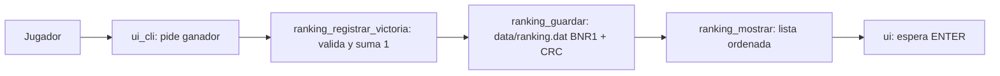

# Batalla Naval (ANSI C)

Juego de Batalla Naval en C estandar (ANSI C / C89), interfaz de consola.
Trabajo final de Algoritmica y Programacion I.

## Integrantes y aportes

| Integrante | Modulo | Aporte |
|---|---|---|
| 1 | Tablero y colocacion (`tablero.c`, parte de `app.c`) | TODO |
| 2 | Flujo e interfaz consola (`app.c`, `ui_cli.c`) | TODO |
| 3 | IA (`ai.c`) | TODO |
| 4 | Ranking, datos y compilacion (`ranking.c`, `config.h`, `Makefile`) | Ranking binario BNR1 v1 en `data/ranking.dat`, config y Makefile |

## Reglas y alcance

- Tablero 10x10, 5 barcos por jugador (5, 4, 3, 2, 1). Ver `include/config.h`.
- Colocacion manual horizontal/vertical, sin salir del tablero ni superponerse.
- Modos: jugador vs jugador y jugador vs maquina.
- Gana quien hunde toda la flota rival.
- Al finalizar: se suma 1 victoria al ganador en `data/ranking.dat`, se muestra
  el ranking ordenado (victorias desc, luego nombre asc) y se espera ENTER.
- Nombres que solo difieren en mayusculas son el mismo jugador.
- El ranking se guarda en formato **binario BNR1 v1**, versionado y con CRC32.
- Detalle del contrato en `docs/contrato-ranking.md`.

## Compilacion y ejecucion

Requisito: GCC o Clang y `make`. El objetivo de compilacion es **Linux**
(probado en WSL/Ubuntu con GCC 15 y GNU Make 4.4).

```sh
# Desde la raiz del proyecto (donde estan Makefile y data/)
make                # compila build/test_ranking y build/demo_ranking
make test           # 132 aserciones del modulo ranking
make demo           # recuerda como correr la demo

./build/demo_ranking "Ana"
xxd data/ranking.dat
```

El programa SIEMPRE se ejecuta desde la raiz, porque la ruta del ranking es
relativa: `data/ranking.dat` (ver `CONFIG_RANKING_RUTA`).

### Linux / WSL

```sh
sudo apt install gcc make
make
make test
```

Si usas WSL, copia el proyecto dentro del filesystem de Linux (no lo ejecutes
desde `/mnt/c`, para evitar problemas de permisos y rendimiento):

```sh
cp -r /mnt/c/Users/gican/Desktop/UNI_projects/demo-batallanaval ~/UNI_projects/demo-batallanaval
cd ~/UNI_projects/demo-batallanaval
make
make test        # 132/132 OK
```

Para trabajar desde VS Code: instala la extension **WSL**, luego
`Ctrl+Shift+P` -> `WSL: Connect to WSL` y abri la carpeta del proyecto.
`build/` esta ignorado en git.

### Windows

No es un objetivo de este entregable. El modulo usa solo ANSI C y
`rename()` de `<stdio.h>`, pero la verificacion oficial se hace en Linux.
Compilar en Windows queda fuera del alcance acordado.

## Organizacion de datos y funciones

```
include/  ranking.h  contrato con app/ui (actualizar, consultar, guardar)
          config.h   tablero y flota configurables, ruta del ranking
src/      main.c         punto de entrada (integracion pendiente)
          ranking.c      logica + persistencia binaria BNR1 (sin UI)
          demo_ranking.c demo de fin de partida
          app.c, ui_cli.c, tablero.c   (otros integrantes)
data/     ranking.dat  formato binario BNR1 v1 (no editar a mano)
tests/    test_ranking.c  pruebas sin frameworks (codigos de retorno)
docs/     contrato-ranking.md
```

Separacion (Anexo A): `ranking.c` valida, ordena y persiste; `ui_cli.c`
pide nombres y muestra mensajes via `ranking_mensaje_error`. Recorrido:
jugador -> interfaz -> `ranking_registrar_victoria` -> interfaz consulta
con `ranking_cantidad`/`ranking_obtener` -> pantalla.



## Formato del archivo (resumen)

```
offset 0   4 bytes   "BNR1"
offset 4   2 bytes   version = 1        (uint16 LE)
offset 6   2 bytes   cantidad 0..100    (uint16 LE)
offset 8   36*n      nombre 32 bytes + victorias 4 bytes (uint32 LE)
final      4 bytes   CRC32 IEEE 802.3 de todo lo anterior
```

Tamano total `12 + 36*n` (12 a 3612 bytes). La escritura es atomica:
primero `data/ranking.dat.tmp` y luego `rename()` sobre el destino.

## Estado del modulo ranking

- [x] `ranking.h` / `ranking.c` en ANSI C, solo stdio/string/ctype.
- [x] Formato binario BNR1 v1 con version, longitud fija y CRC32.
- [x] Escritura atomica con archivo temporal y `rename()`.
- [x] `make test` con 132 aserciones (CRC, formato, corrupcion, orden,
      mayusculas, capacidad, errores de API y roundtrip).
- [x] `demo_ranking` demuestra el flujo exigido por la consigna.
- [ ] `make app`: integracion completa pendiente; `app.c`, `ui_cli.c` y
      `tablero.c` todavia no compilan en `-ansi`.
