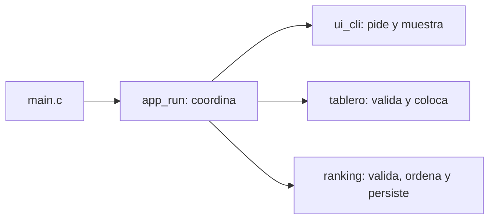

# Batalla Naval (C99)

Juego de Batalla Naval en C99, interfaz de consola.
Trabajo final de Algoritmica y Programacion I.

## Integrantes y aportes

| Integrante | Modulo | Aporte |
|---|---|---|
| 1 | Tablero y colocacion (`tablero.c`, `include/tablero.h`) | Tablero, validacion de coordenadas y colocacion de barcos |
| 2 | Flujo e interfaz consola (`app.c`, `ui_cli.c`) | Presentacion, reglamento, menu y entrada de datos |
| 3 | IA (`ai.c`) | Pendiente de integracion |
| 4 | Ranking, datos y compilacion (`ranking.c`, `config.h`, `Makefile`) | Ranking binario en `data/ranking.dat`, configuracion, Makefile y migracion del proyecto a C99 |

## Reglas y alcance

- Tablero 10x10, 5 barcos por jugador (5, 4, 3, 2, 1). Ver `include/config.h`.
- Colocacion manual horizontal/vertical, sin salir del tablero ni superponerse.
- Modos: jugador vs jugador y jugador vs maquina.
- Gana quien hunde toda la flota rival.
- Al finalizar una partida se suma 1 victoria al ganador en `data/ranking.dat`,
  se muestra el ranking ordenado (victorias desc, luego nombre asc) y se espera
  ENTER.
- Nombres que solo difieren en mayusculas son el mismo jugador.
- El ranking se guarda en **binario**: un volcado directo del struct
  `Ranking` (3604 bytes), sin magic, version ni checksum.
- Detalle del contrato y limitaciones en `docs/contrato-ranking.md`.

## Estado actual

- `ranking.c` / `ranking.h`: completo, con persistencia binaria, validacion y
  68 pruebas automaticas.
- `tablero.c` / `tablero.h`: inicializacion, validacion de rango, control de
  superposicion/contacto, colocacion y dibujo de los dos tableros, con 26
  pruebas automaticas.
- `ui_cli.c` / `ui_cli.h`: presentacion, reglamento, captura de nombres y menu.
- `app.c` / `app.h`: coordina presentacion, reglamento y menu.
- `main.c`: solo llama a `app_run()`.
- `make app` compila y ejecuta el esqueleto completo.
- Pendiente: motor de partida (`game.c`), IA (`ai.c`) y registro automatico de
  la victoria en el ranking al terminar una partida.

## Estandar: C99

Todo el proyecto se compila con:

```sh
-std=c99 -pedantic -Wall -Wextra
```

Se adopto C99 porque los modulos de interfaz y tablero ya usan comentarios
`//` y declaraciones dentro de `for`, que son validas desde C99. La consigna
solo exige "lenguaje C"; C99 es un estandar ISO de C y permite mantener un
unico modo de compilacion para todos los archivos. `ranking.c` sigue siendo
valido tambien en C89, pero se compila junto al resto en C99.

## Compilacion y ejecucion

Requisito: GCC o Clang y `make`. El objetivo de compilacion es **Linux**
(probado en WSL/Ubuntu con GCC 15 y GNU Make 4.4; tambien verificado en
Windows con LLVM-MinGW 22).

```sh
# Desde la raiz del proyecto (donde estan Makefile, data/ y files/)
make                # compila el juego, la demo y las pruebas
make test           # 68 aserciones de ranking + 26 de tablero
make app            # compila solo el juego
make run            # compila y ejecuta el juego
make demo           # compila la demo de fin de partida

./build/batalla-naval
./build/demo_ranking "Ana"
ls -l data/ranking.dat     # 3604 bytes
```

El programa SIEMPRE se ejecuta desde la raiz, porque las rutas son relativas:

- `data/ranking.dat` (`CONFIG_RANKING_RUTA`);
- `files/Reglamento.txt` (`CONFIG_REGLAMENTO_RUTA`).

Flujo de `./build/batalla-naval` en el estado actual:

1. pide el nombre del jugador 1;
2. muestra `files/Reglamento.txt` y espera ENTER;
3. muestra el menu principal;
4. si se elige un modo, informa la eleccion y espera ENTER;
5. si se elige `0`, sale.

### Linux / WSL

```sh
sudo apt install gcc make
make
make test
make run
```

Si usas WSL, copia el proyecto dentro del filesystem de Linux (no lo ejecutes
desde `/mnt/c`, para evitar problemas de permisos y rendimiento):

```sh
cp -r /mnt/c/Users/gican/Desktop/UNI_projects/demo-batallanaval ~/UNI_projects/demo-batallanaval
cd ~/UNI_projects/demo-batallanaval
make
make test        # 68/68 ranking + 26/26 tablero
```

Para trabajar desde VS Code: instala la extension **WSL**, luego
`Ctrl+Shift+P` -> `WSL: Connect to WSL` y abri la carpeta del proyecto.
`build/` esta ignorado en git.

### Windows

Compatible con LLVM-MinGW (clang). Compilacion manual desde Git Bash:

```sh
clang -std=c99 -pedantic -Wall -Wextra -Iinclude tests/test_ranking.c src/ranking.c -o build/test_ranking.exe
clang -std=c99 -pedantic -Wall -Wextra -Iinclude tests/test_tablero.c src/tablero.c -o build/test_tablero.exe
clang -std=c99 -pedantic -Wall -Wextra -Iinclude src/demo_ranking.c src/ranking.c -o build/demo_ranking.exe
clang -std=c99 -pedantic -Wall -Wextra -Iinclude src/main.c src/app.c src/ui_cli.c src/tablero.c src/ranking.c -o build/batalla-naval.exe
./build/test_ranking.exe
./build/test_tablero.exe
./build/batalla-naval.exe
```

La verificacion oficial sigue siendo Linux; en Windows el modo binario
`"wb"`/`"rb"` del ranking es obligatorio para que los enteros no se corrompan.
La interfaz de consola usa `cls` en Windows y `clear` en Linux; si `clear` no
esta disponible, imprime lineas en blanco.

## Organizacion de archivos y funciones

```text
include/  app.h        punto de entrada de la aplicacion (app_run)
          ui_cli.h     interfaz de consola (pedir/mostrar)
          tablero.h    tipos y reglas de tablero
          ranking.h    contrato del ranking
          config.h     tablero, flota, nombres y rutas configurables
src/      main.c       solo llama a app_run()
          app.c        coordina pantallas y menu
          ui_cli.c     limpia pantalla, pide datos, muestra textos
          tablero.c    inicializa, valida y coloca barcos
          ranking.c    logica + persistencia binaria (sin UI)
          demo_ranking.c demo de fin de partida
tests/    test_ranking.c  pruebas del ranking sin frameworks externos
          test_tablero.c  pruebas de limites, contacto y colocacion
data/     ranking.dat  volcado binario del struct (no editar a mano)
files/    Reglamento.txt  texto que muestra la presentacion
docs/     contrato-ranking.md, proyecto.md
```

Separacion (Anexo A):



`ranking.c` es la unica capa que decide reglas del ranking. La interfaz pide
el nombre y traduce el codigo de retorno con `ranking_mensaje_error`; nunca
toca `entradas` ni suma victorias por su cuenta.

## Formato del archivo de ranking (resumen)

```text
offset 0     3600 bytes   100 entradas x 36 bytes
                          +0  char nombre[32]
                          +32 int  victorias
offset 3600     4 bytes   int cantidad (0..100)
TOTAL        3604 bytes
```

- Se escribe con `fwrite` de una copia normalizada a ceros del struct.
- Se lee con `fread` y se valida: tamano exacto, `cantidad`, `'\0'` en cada
  nombre y rango de victorias.
- Sin checksum no se detecta un byte alterado que siga siendo valido.
  Ver "Modelo de amenaza" en `docs/contrato-ranking.md`.

## Pruebas

```sh
make test           # ambas suites
make test-ranking   # solo ranking
make test-tablero   # solo tablero
```

La suite incluye 68 aserciones de ranking y 26 de tablero.

Ranking: registro y acumulacion, identidad insensible a mayusculas, nombres
invalidos, orden y desempate, roundtrip binario, archivo inexistente, archivos
vacios/truncados/con bytes de mas, `cantidad` y victorias fuera de rango,
nombres sin `'\0'`, carga parcial, duplicados, determinismo del guardado, tope
de 100 jugadores y errores de API.

Tablero: inicializacion, limites en horizontal/vertical, ultima fila/columna,
orientacion y tamanio invalidos, superposicion, contacto lateral y diagonal,
separacion con una casilla de agua, marcado horizontal/vertical y colocacion
invalida que no modifica el tablero.

## Estado de integracion

- [x] `ranking.h` / `ranking.c` en C99, solo stdio/string/ctype.
- [x] Formato binario (volcado del struct), lectura validada y guardado
      deterministico (los bytes libres siempre quedan en cero).
- [x] Asserts de compilacion para detectar padding/cambios de layout.
- [x] `make test` con 68 aserciones de ranking y 26 de tablero.
- [x] `demo_ranking` demuestra el flujo exigido por la consigna.
- [x] `make app` compila `main.c`, `app.c`, `ui_cli.c`, `tablero.c` y
      `ranking.c` con C99, sin warnings.
- [x] Presentacion, reglamento y menu ejecutables.
- [ ] Motor de partida (`game.c`) e IA (`ai.c`).
- [ ] Registro automatico del ganador en el ranking al finalizar la partida.
