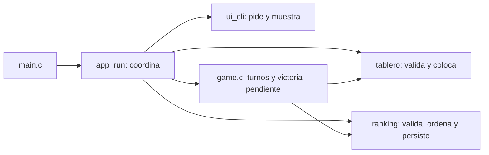

# Batalla Naval (C99)

Juego de Batalla Naval en C99, interfaz de consola.
Trabajo final de Algoritmica y Programacion I.

C99 es el estandar unico de toda la rama. La logica del juego, la interfaz,
la persistencia del ranking y las pruebas se compilan con el mismo conjunto
de flags y sin extensiones del compilador.

## 1. Integrantes y aportes

| Integrante | Modulo | Aporte |
|---|---|---|
| 1 | Tablero y colocacion (`tablero.c`, `include/tablero.h`) | Tablero, validacion de coordenadas, contacto entre barcos y colocacion |
| 2 | Flujo e interfaz consola (`app.c`, `ui_cli.c`) | Presentacion, reglamento, menu y entrada de datos |
| 3 | IA (`ai.c`) | Pendiente de integracion |
| 4 | Ranking, datos y compilacion (`ranking.c`, `config.h`, `Makefile`) | Ranking binario en `data/ranking.dat`, configuracion, Makefile y estandar C99 |

Los nombres y las horas aproximadas se informan en la entrega final.

## 2. Reglas y alcance

- Tablero de 10 x 10 casillas y 5 barcos por jugador, de longitudes 5, 4, 3,
  2 y 1. Los valores viven en `include/config.h`.
- Cada jugador coloca sus barcos manualmente, en horizontal o vertical.
- Un barco no puede salir del tablero, superponerse ni tocar a otro. La regla
  actual exige al menos una casilla de agua alrededor, incluidas las diagonales.
- Dos modalidades: jugador contra jugador y jugador contra maquina.
- En cada turno se dispara a una coordenada; un impacto se marca con `X` y un
  disparo al agua con `/`.
- Gana quien primero hunde toda la flota rival.
- Al terminar una partida se suma una victoria al ganador, se guarda el ranking
  y se muestra ordenado por victorias descendentes y luego por nombre.
- Los nombres que solo difieren en mayusculas son el mismo jugador. Se valida
  un largo de 1 a 31 caracteres, sin caracteres de control.
- El ranking se guarda en **binario**: un volcado directo del struct `Ranking`
  de 3604 bytes, sin magic number, version ni checksum.
- El programa se ejecuta siempre desde la raiz del proyecto, porque las rutas
  de `data/ranking.dat` y `files/Reglamento.txt` son relativas.

El motor de partida (`game.c`) y la IA (`ai.c`) todavia no estan integrados.
El estado actual del programa se detalla en la seccion 3.

## 3. Estado actual

- `include/config.h`: tablero, flota, cantidad de jugadores, largo de nombres y
  rutas configurables.
- `tablero.c` / `tablero.h`: inicializacion, validacion de rango, control de
  superposicion y contacto, colocacion y dibujo de los dos tableros.
- `ui_cli.c` / `ui_cli.h`: presentacion, reglamento, captura robusta de nombres
  y menu principal con validacion de opciones.
- `app.c` / `app.h`: coordina presentacion, reglamento y menu; deja preparado el
  punto de integracion del motor y del cierre con ranking.
- `ranking.c` / `ranking.h`: registro de victorias, busqueda insensible a
  mayusculas, orden, persistencia binaria y validacion del archivo.
- `main.c`: solo llama a `app_run()`. No contiene menus, reglas ni persistencia.
- `tests/test_ranking.c`: 68 aserciones del ranking.
- `tests/test_tablero.c`: 26 aserciones del tablero.
- `src/demo_ranking.c`: demuestra el flujo de fin de partida y genera un
  `data/ranking.dat` real de 3604 bytes.

`make app` compila el esqueleto actual y `make run` lo ejecuta: presentacion,
reglamento y menu. La partida completa queda pendiente hasta integrar `game.c`
y `ai.c`.

## 4. Estandar C99

### 4.1 Un solo estandar para toda la rama

Todos los archivos se compilan con:

```sh
-std=c99 -pedantic -Wall -Wextra
```

Reglas del proyecto:

- C99 (ISO/IEC 9899:1999) es el unico estandar de compilacion.
- No se mantiene un modo de compilacion alternativo.
- `-pedantic` rechaza extensiones del compilador: el codigo se mantiene dentro
  de C99.
- `-Wall -Wextra` estan activados y el build debe quedar sin warnings.
- El mismo estandar se usa para el juego, la demo y las dos suites de pruebas.
- GCC, Clang y LLVM-MinGW deben aceptar los mismos archivos sin cambios.

### 4.2 Decisiones de implementacion

- Solo se usan headers estandar de C: `<stdio.h>`, `<stdlib.h>`, `<string.h>`,
  `<ctype.h>` y `<stddef.h>`.
- No hay dependencias externas ni frameworks de prueba.
- Las diferencias entre Windows y Linux se concentran en `ui_cli.c`:
  `cls` en Windows y `clear` en Linux/Unix.
- El ranking abre siempre en modo binario (`"wb"`/`"rb"`), para que los enteros
  no se corrompan con la traduccion de fin de linea de Windows.
- Los tamanios del tablero y de la flota son constantes de compilacion
  configurables en `config.h`; no se repiten literales en la logica.
- La memoria es estatica: no se usa `malloc` ni `free`.
- Las funciones internas son `static`; la API publica vive en los headers.
- La autodocumentacion esta en espanol y explica el por que de cada decision,
  no solo lo que hace el codigo.

### 4.3 Que resuelve C99 en este proyecto

C99 permite escribir la logica y las reglas de negocio con un subconjunto
portable y moderno del lenguaje, sin atarse a un sistema operativo ni a un
compilador. En particular, el proyecto aprovecha que C99:

- es un estandar ISO ampliamente soportado por GCC, Clang y LLVM-MinGW;
- permite un unico modo de compilacion para todos los modulos;
- provee las funciones estandar de `<stdio.h>`, `<stdlib.h>`, `<string.h>`
  y `<ctype.h>` que usa el proyecto;
- mantiene el codigo portable sin extensiones del compilador.

El codigo se mantiene deliberadamente simple y compila con `-pedantic`, que es
la garantia de que no se colaron extensiones.

## 5. Trazabilidad de requisitos

| Requisito de la consigna | Implementacion C99 | Estado |
|---|---|---|
| Tablero de 10 x 10 | `config.h` (`CONFIG_FILAS`, `CONFIG_COLUMNAS`) y `tablero.c` | Completo |
| 5 barcos de 5, 4, 3, 2 y 1 | `config.h` y `tablero.h` (`Tamanio`) | Completo |
| Colocacion manual horizontal/vertical | `tablero.c` (`rango`, `libre`, `ingresar_barco`) | Completo |
| Validacion de limites y superposicion | `rango()` y `libre()` | Completo |
| Dos modalidades de juego | `ModoJuego` en `ui_cli.h` y menu en `app.c` | Menu completo; partida pendiente |
| Turnos, disparos y condicion de victoria | `game.c` | Pendiente |
| IA que no repite disparos | `ai.c` | Pendiente |
| Registro de victorias por nombre | `ranking.c` (`ranking_registrar_victoria`) | Completo |
| Ranking ordenado y persistente | `ranking.c` (`ranking_ordenar`, `ranking_guardar`) | Completo |
| Archivo `ranking.dat` binario | `fwrite`/`fread` del struct de 3604 bytes | Completo |
| Windows y Linux | `ui_cli.c` y modo binario de `fopen` | Verificado |
| README con reglas y compilacion | Este archivo | Completo |

## 6. Compilacion y ejecucion

Requisito: GCC o Clang y `make`. El objetivo oficial de compilacion es
**Linux** (probado en WSL/Ubuntu con GCC 15.2.0 y GNU Make 4.4.1) y tambien se
verifica en **Windows** con LLVM-MinGW (clang 22.1.8).

```sh
# Desde la raiz del proyecto (donde estan Makefile, data/ y files/)
make                # compila el juego, la demo y las dos suites
make app            # compila solo el juego
make test           # ejecuta ranking + tablero
make test-ranking   # ejecuta solo ranking
make test-tablero   # ejecuta solo tablero
make run            # compila y ejecuta el juego
make demo           # compila la demo de fin de partida
make clean          # borra binarios y temporales de prueba

./build/batalla-naval
./build/demo_ranking "Ana"
ls -l data/ranking.dat     # 3604 bytes
```

El programa SIEMPRE se ejecuta desde la raiz, porque las rutas son relativas:

- `data/ranking.dat` (`CONFIG_RANKING_RUTA`);
- `files/Reglamento.txt` (`CONFIG_REGLAMENTO_RUTA`).

Flujo actual de `./build/batalla-naval`:

1. pide el nombre del jugador 1;
2. muestra `files/Reglamento.txt` y espera ENTER;
3. muestra el menu principal;
4. si se elige un modo, informa la eleccion y espera ENTER;
5. si se elige `0`, sale.

### 6.1 Linux / WSL

```sh
sudo apt install gcc make
make
make test
make run
```

Si usas WSL, copia el proyecto dentro del filesystem de Linux (no lo ejecutes
desde `/mnt/c`, para evitar problemas de permisos y rendimiento):

```sh
cp -r /mnt/c/Users/gican/Desktop/UNI_projects/demo-batallanaval ~/UNI_projects/demo-batallanaval
cd ~/UNI_projects/demo-batallanaval
make
make test        # 68/68 ranking + 26/26 tablero
```

Para trabajar desde VS Code: instala la extension **WSL**, luego
`Ctrl+Shift+P` -> `WSL: Connect to WSL` y abri la carpeta del proyecto.
`build/` esta ignorado en git.

### 6.2 Windows

Compatible con LLVM-MinGW (clang). Compilacion manual desde Git Bash:

```sh
clang -std=c99 -pedantic -Wall -Wextra -Iinclude tests/test_ranking.c src/ranking.c -o build/test_ranking.exe
clang -std=c99 -pedantic -Wall -Wextra -Iinclude tests/test_tablero.c src/tablero.c -o build/test_tablero.exe
clang -std=c99 -pedantic -Wall -Wextra -Iinclude src/demo_ranking.c src/ranking.c -o build/demo_ranking.exe
clang -std=c99 -pedantic -Wall -Wextra -Iinclude src/main.c src/app.c src/ui_cli.c src/tablero.c src/ranking.c -o build/batalla-naval.exe
./build/test_ranking.exe
./build/test_tablero.exe
./build/batalla-naval.exe
```

La verificacion oficial sigue siendo Linux. En Windows, el modo binario
`"wb"`/`"rb"` del ranking es obligatorio para que los enteros no se corrompan.
La interfaz usa `cls` en Windows y `clear` en Linux; si `clear` no esta
disponible, imprime lineas en blanco.

## 7. Organizacion de archivos y funciones

```text
include/  app.h        punto de entrada de la aplicacion (app_run)
          ui_cli.h     interfaz de consola (pedir/mostrar)
          tablero.h    tipos y reglas de tablero
          ranking.h    contrato del ranking
          config.h     tablero, flota, nombres y rutas configurables
src/      main.c       solo llama a app_run()
          app.c        coordina pantallas y menu
          ui_cli.c     limpia pantalla, pide datos, muestra textos
          tablero.c    inicializa, valida y coloca barcos
          ranking.c    logica + persistencia binaria (sin UI)
          demo_ranking.c demo de fin de partida
tests/    test_ranking.c  pruebas del ranking sin frameworks externos
          test_tablero.c  pruebas de limites, contacto y colocacion
data/     ranking.dat  volcado binario del struct (no editar a mano)
files/    Reglamento.txt  texto que muestra la presentacion
docs/     contrato-ranking.md, proyecto.md
```

Arquitectura por capas:

| Capa | Archivos | Responsabilidad |
|---|---|---|
| Entrada | `main.c` | Llamar a `app_run()` y devolver su codigo de salida |
| Aplicacion | `app.c`, `app.h` | Decidir el orden de las pantallas y conectar los modulos |
| Interfaz | `ui_cli.c`, `ui_cli.h` | Pedir y mostrar; nunca aplicar reglas ni tocar datos |
| Dominio | `tablero.c`, `ranking.c` | Validar, calcular y persistir segun las reglas |
| Configuracion | `config.h` | Centralizar tamanios, flota, nombres y rutas |
| Pruebas | `tests/` | Verificar las reglas sin frameworks externos |

Separacion (Anexo A):



`ranking.c` es la unica capa que decide reglas del ranking. La interfaz pide
el nombre y traduce el codigo de retorno con `ranking_mensaje_error`; nunca
toca `entradas` ni suma victorias por su cuenta. `tablero.c` es la unica capa
que decide si un barco entra, si se superpone o si toca a otro.

## 8. Formato del archivo de ranking

```text
offset 0     3600 bytes   100 entradas x 36 bytes
                          +0  char nombre[32]
                          +32 int  victorias
offset 3600     4 bytes   int cantidad (0..100)
TOTAL        3604 bytes
```

- Se escribe con `fwrite` de una copia normalizada a ceros del struct.
- Se lee con `fread` y se valida: tamano exacto, `cantidad`, `'\0'` en cada
  nombre y rango de victorias.
- Los slots libres y la cola de cada nombre quedan en cero, para que el archivo
  sea deterministico y no filtre memoria del proceso.
- Sin checksum no se detecta un byte alterado que siga siendo valido. Ver
  "Modelo de amenaza" en `docs/contrato-ranking.md`.
- El formato asume `int` de 4 bytes, little-endian y sin padding (x86_64 en
  Linux y Windows). Los asserts de compilacion de `ranking.c` detectan cambios
  de layout.

## 9. Pruebas

```sh
make test           # ambas suites
make test-ranking   # solo ranking
make test-tablero   # solo tablero
```

La suite incluye **68 aserciones de ranking** y **26 de tablero**.

Ranking: registro y acumulacion, identidad insensible a mayusculas, nombres
invalidos, orden y desempate, roundtrip binario, archivo inexistente, archivos
vacios/truncados/con bytes de mas, `cantidad` y victorias fuera de rango,
nombres sin `'\0'`, carga parcial, duplicados, determinismo del guardado, tope
de 100 jugadores y errores de API.

Tablero: inicializacion, limites en horizontal/vertical, ultima fila/columna,
orientacion y tamanio invalidos, superposicion, contacto lateral y diagonal,
separacion con una casilla de agua, marcado horizontal/vertical y colocacion
invalida que no modifica el tablero.

Las pruebas no usan CUnit, Unity ni ningun framework externo: cada suite
cuenta sus aserciones, imprime `ok`/`FALLO` y devuelve 0 o 1 segun el resultado.
`make test` propaga ese codigo de salida. Los archivos temporales se llaman
`data/ranking_test_*.dat` y se limpian con `make clean`.

No se captura stdout en las pruebas: el dibujo de `mostrar_tablero()` y el
flujo completo de la app se verifican manualmente.

## 10. Verificacion realizada

| Entorno | Compilador | Build | Pruebas | App |
|---|---|---|---|---|
| Linux/WSL (oficial) | GCC 15.2.0, GNU Make 4.4.1 | 4 binarios, 0 warnings | 68/68 + 26/26 | Presentacion, reglamento, menu y salida correctos |
| Windows | LLVM-MinGW clang 22.1.8 | 4 binarios, 0 warnings | 68/68 + 26/26 | Ejecuta y encuentra `files/Reglamento.txt` |

Verificaciones adicionales:

- `data/ranking.dat` generado por `demo_ranking`: **3604 bytes**.
- La app responde a una entrada real (`Ana`, ENTER, `0`) y termina con codigo 0.
- El arbol de trabajo queda limpio despues de compilar; `build/` esta ignorado.
- `data/ranking.dat` esta ignorado por git para no subir victorias de prueba.

## 11. Estado de integracion

- [x] C99 como estandar unico de toda la rama.
- [x] `ranking.h` / `ranking.c` con persistencia binaria y 68 pruebas.
- [x] `tablero.h` / `tablero.c` con reglas, dibujo y 26 pruebas.
- [x] `ui_cli.h` / `ui_cli.c` con entrada robusta y menu validado.
- [x] `app.h` / `app.c` coordinando presentacion, reglamento y menu.
- [x] `main.c` minimo, solo llama a `app_run()`.
- [x] `make app` compila `main.c`, `app.c`, `ui_cli.c`, `tablero.c` y
      `ranking.c` con C99, sin warnings.
- [x] `make test` ejecuta las dos suites.
- [x] Verificacion en Linux y Windows.
- [ ] Motor de partida (`game.c`): turnos, disparos y condicion de victoria.
- [ ] IA (`ai.c`): disparos de la maquina sin repetir coordenadas.
- [ ] Registro automatico del ganador en el ranking al finalizar la partida.
- [ ] Partida completa de punta a punta.

## 12. Decisiones para la defensa

- **Un solo estandar:** C99 para logica, interfaz, persistencia y pruebas.
  No hay un modo de compilacion alternativo ni dependencias del sistema.
- **Separacion de capas:** `main.c` solo arranca; `app.c` coordina; `ui_cli.c`
  pide y muestra; `tablero.c` y `ranking.c` aplican las reglas.
- **Ranking binario (Opcion A):** se eligio el volcado directo del struct por
  decision del grupo. Es simple y rapido, pero no tiene magic number, version
  ni checksum; sus limitaciones estan documentadas y asumidas.
- **Guardado deterministico:** se copia el struct a una variable local, se pone
  todo a cero con `memset` y se copian solo los datos validos. Asi los bytes
  libres no filtran memoria y el archivo es reproducible.
- **Entrada robusta:** se lee con `fgets` y se convierte con `strtol`; se
  consumen lineas completas y se maneja EOF para evitar bucles infinitos.
- **Pruebas sin frameworks:** dos suites minimas, con codigo de salida claro y
  ejecutables desde `make test`.
- **Pendiente honesto:** el motor y la IA no estan integrados; el README y la
  app lo dicen explicitamente en lugar de simular una partida completa.

## 13. Documentos relacionados

- `docs/contrato-ranking.md`: contrato completo del ranking, layout, validacion,
  modelo de amenaza e historial de decision.
- `docs/proyecto.md`: documento general del proyecto, alcance y arquitectura.
- `files/Reglamento.txt`: texto que muestra la pantalla de presentacion.
- `ConsignaTrabajoIntegrador.pdf`: consigna oficial de la catedra.
- `README_gian.md`: este documento.
